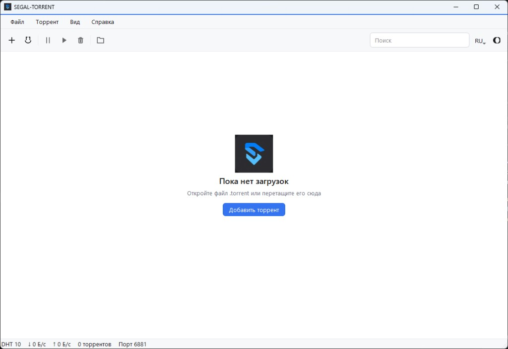
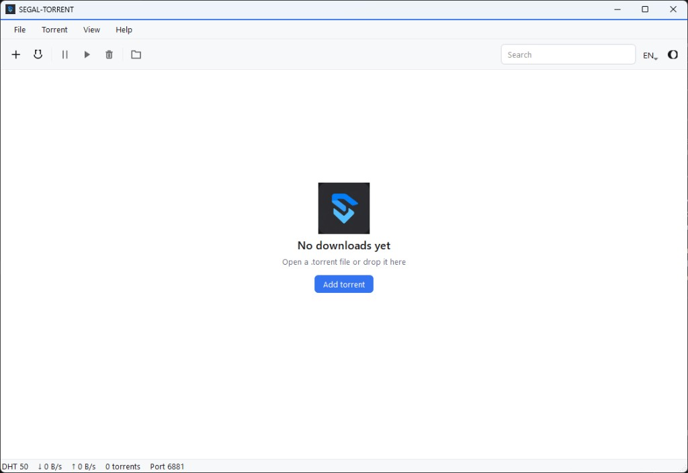

# SEGAL-TORRENT

Fast Windows torrent client. Russian and English, dark and light themes. No account.

Developer: Dan Segal  
Site: https://daniilcg.github.io/SEGAL-TORRENT/

## Interface

Russian and English.




## Download

Windows 10/11: [SEGAL-TORRENT.exe](download/SEGAL-TORRENT.exe) (49.9 MB).

## Run from source

Python 3.12 on Windows:

```
python -m venv .venv
.venv\Scripts\python.exe -m pip install -r requirements.txt
.venv\Scripts\python.exe main.py
```

## Build one exe

```
.venv\Scripts\python.exe build.py
```

The executable is written to `dist\SEGAL-TORRENT.exe`.

## License

MIT. See [LICENSE](LICENSE).
